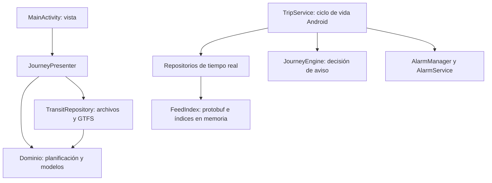

# SleepTrain 0.4 — arquitectura y comportamiento

## Capas

Se utiliza una separación por capas con un presentador ligero. No se requiere un framework MVC ni una base de datos.

`domain` y `core` no dependen de Android, JSON, HTTP ni almacenamiento. `data` convierte GTFS/GTFS-RT en modelos y observaciones. `presentation` coordina trabajo fuera del hilo de interfaz. Las clases del paquete raíz adaptan el sistema Android: permisos, sesión, servicios, notificación y sonido.

## Datos sin base de datos

El catálogo empaquetado usa `schema: 2` y contiene líneas independientes `RENFE_C5` y `METRO_L3`. Cada línea tiene estaciones, tiempos por tramo, metadatos de procedencia/vigencia, IDs de rutas y operadores, y viajes programados. Los índices se crean en memoria: estación → orden, viaje → datos del viaje, y parada → índice dentro del viaje. No se mezclan IDs de operadores diferentes.

Cada viaje conserva `trip_id`, `route_id`, fechas de servicio, IDs de parada, `stop_sequence` y tiempos desde el inicio de día GTFS. Se admiten servicios parciales de C5, ambos sentidos y horas superiores a 24:00:00. Las horas se interpretan en Europe/Madrid con mediodía local menos doce horas. Los viajes por frecuencias no se presentan como un tren único seleccionable.

Las actualizaciones estáticas se descargan a archivos temporales y se leen como CSV en streaming; solo se retienen los tiempos de las líneas del piloto, mediante registros compactos. Se validan antes de sustituir cada caché con `AtomicFile`. Si una línea falla, se conserva su caché previa. El catálogo incluido es el último respaldo. No se usa el JSON para consultar relaciones: una vez cargado, se trabaja con modelos e índices.

La referencia de C5 tiene 23 estaciones, de Móstoles El Soto a Humanes. La L3 tiene 19, de Moncloa a El Casar. El GTFS de Metro comprobado no tiene viajes L3 y su calendario acaba el 27/05/2026; no se cambia ese calendario ni se fabrican trenes. Se completa el orden usando la ficha actual del CRTM y se señalan tiempos provisionales: 120 s por tramo, 180 s Villaverde Alto–El Casar. El punto de El Casar no se presenta como andén L3 contrastado.

## Fuentes en tiempo real

Renfe se consulta directamente, cada veinte segundos durante un tramo activo:

- `https://gtfsrt.renfe.com/vehicle_positions.pb`
- `https://gtfsrt.renfe.com/trip_updates.pb`
- `https://gtfsrt.renfe.com/alerts.pb`

Se usa el binding Java de MobilityData para decodificar Protocol Buffers. `FeedIndex` reemplaza snapshots completos y combina feeds diferenciales, incluidos borrados `is_deleted`. Descarta cabeceras antiguas, futuras o anteriores a la última aceptada. Una entidad retenida sin cambios en un feed diferencial no adquiere una fecha nueva por recibir otra cabecera.

La posición y la actualización de viaje se cruzan por `trip_id` exacto, comprobando `start_date` y `route_id` cuando aparecen. No se asigna el tren por proximidad de hora ni por una etiqueta como “C5”. Un `stop_sequence` se resuelve mediante el viaje estático. Si no hay coincidencia, se conserva el modo estimado y se explica que hay que asociar un tren.

- Posiciones: se exige una marca de vehículo reciente; `STOPPED_AT` confirma estación y `INCOMING_AT` puede avisar antes de llegar. `IN_TRANSIT_TO` no equivale a llegada.
- Previsiones: se usa la llegada del aviso o el desfase publicado aplicado al horario enlazado. `NO_DATA` elimina la inferencia correspondiente; ausencia de datos no significa retraso cero.
- Cancelación o supresión de la parada del aviso/destino: despierta al usuario con el motivo.
- Incidencias: se comprueba el periodo activo y todos los campos de cada selector. Se muestran solo las que afectan al recorrido; `NO_SERVICE` genera un aviso crítico. Las informativas no hacen sonar por sí solas una alarma.

Las observaciones de progreso y previsiones caducan a los 60 s. Se admite un desfase futuro de hasta 10 s; relojes del móvil incorrectos pueden causar rechazo de datos y paso al respaldo.

No se ha localizado un GTFS-RT público operativo para Metro. El adaptador REST de teleindicadores usa únicamente los códigos contrastados `0304` (Embajadores) y `0357` (Villaverde Alto), valida L3, nombre de estación, sentido y fecha de emisión. Muestra el próximo tiempo disponible, ajustado desde su emisión, y acepta valores nulos. Es contexto de panel, sin ID de circulación: **no actualiza la posición ni el temporizador del tren del pasajero**. Investigación reproducible en `METRO_DATA_RESEARCH.md`.

## Viajes y transbordos

La vista ofrece Metro, Cercanías y transbordo en ambos órdenes. Se usan correspondencias explícitas, no nombres parecidos ni coordenadas próximas:

| Intercambiador | Parada Metro L3 | Parada Renfe C5 |
| --- | --- | --- |
| Embajadores | `par_4_46` | `35609` |
| Villaverde Alto | `par_4_273` | `37001` |

El cambio recomendado minimiza duraciones nominales de los tramos más cinco minutos de caminata provisionales; no calcula esperas reales ni garantiza enlace. También puede elegirse el intercambiador manualmente. Se omiten tramos sin movimiento y se rechaza un viaje cuyo origen y destino sean el mismo intercambiador.

La sesión contiene los tramos ya recortados, el tramo activo, configuración de sonido, tren asociado automáticamente y referencias temporales. Cada tramo nuevo recibe un token distinto. El ciclo es:

1. Confirmar salida → tramo activo y respaldo armado.
2. Aviso → sonido y vibración hasta reconocerlo.
3. Si queda otro tramo, reconocer → espera de transbordo, sin alarma de tramo armada.
4. Seleccionar opcionalmente el siguiente tren y confirmar su salida → nuevo token y siguiente tramo.
5. Reconocer el último aviso o cancelar el viaje → eliminar sesión y alarmas.

Los receptores y resultados asíncronos comprueban token y fase para ignorar avisos del tramo anterior. El contador de arranque del teléfono impide recuperar una sesión anterior a un reinicio. Una sesión antigua de 0.1 puede terminar con su respaldo, pero no incorpora una planificación de transbordos retroactiva.

## Decisión de aviso y servicios

Todo el cálculo de plazos usa tiempo monotónico (`elapsedRealtime`). La ubicación está siempre habilitada durante el tramo y corrige la ruta local. Las lecturas precisas y recientes tienen prioridad sobre los feeds; si no hay permiso o señal útil, se mantienen las fuentes del operador y la estimación. `StationMatcher` acepta una lectura fuerte inmediata, corrobora las de menor precisión y proyecta entre estaciones solo dentro de un corredor estrecho.

`JourneyEngine` guarda posición fraccional, último anclaje GPS, ritmo observado y calibración entre estaciones. Una corrección GPS puede retroceder una estimación adelantada y reanclar una espera en la misma estación; los duplicados no la prolongan. Durante 30 s una posición anterior al aviso evita que el temporizador contradiga al móvil. La llegada al aviso prevalece. Se rechazan observaciones remotas anteriores al GPS; los datos de Renfe posteriores vuelven a utilizarse cuando caduca la prioridad.

Con previsión válida de Renfe y sin GPS prioritario, se avisa treinta segundos antes de la llegada. Se guarda su caducidad y el respaldo del sistema revisa el primero de los plazos de aviso/caducidad. Sin previsión, se usa la duración nominal restante desde la última posición corregida, ajustada gradualmente por los intervalos medidos y con un margen fijo de 15 s. No se acumula un adelanto porcentual sobre toda la ruta. `SessionStore.capture` persiste el mismo estado que reconstruye el receptor, incluso si ya existía una alarma programada antes de corregirse la posición.

El comportamiento de posición está en [GPS_CORRECTION.md](GPS_CORRECTION.md). La asociación automática de Renfe, su tratamiento de incidencias y la salida de sonido única se detallan en [AUTOMATIC_TRACKING.md](AUTOMATIC_TRACKING.md). `AutoTrainMatcher` cruza IDs exactos con observaciones de movimiento; la ambigüedad mantiene el seguimiento local sin elegir un tren arbitrario.

El servicio en primer plano del viaje usa `specialUse` para el seguimiento del aviso iniciado por el usuario, sin requisitos de GPS; añade `location` siempre que estén disponibles el permiso y el servicio de ubicación. Se declara el subtipo del servicio en el manifest. El sonido usa un servicio `mediaPlayback` separado. No se mantienen servicios de sonido sin reproducción ni se pide ubicación permanente.

## Audio, persistencia y límites

La salida es siempre automática: auriculares conectados o altavoz en su ausencia, con vibración de respaldo y prueba de cinco segundos. Se conserva la vibración adicional configurable. El tono empieza silenciado hasta consultar la salida efectiva. Se respeta el volumen global y No molestar. Enrutamiento, restricciones de batería y funcionamiento con la pantalla apagada requieren pruebas físicas por modelo de teléfono.

La sesión y preferencias se guardan en almacenamiento privado; la cancelación se persiste antes de procesar nuevos avisos. No se envían coordenadas a los operadores. Las peticiones revelan la IP del dispositivo. Forzar detención, retirar permisos o reiniciar puede interrumpir el aviso. En túnel sigue siendo necesaria una conexión para consultar datos en tiempo real; sin ella solo existe estimación.
